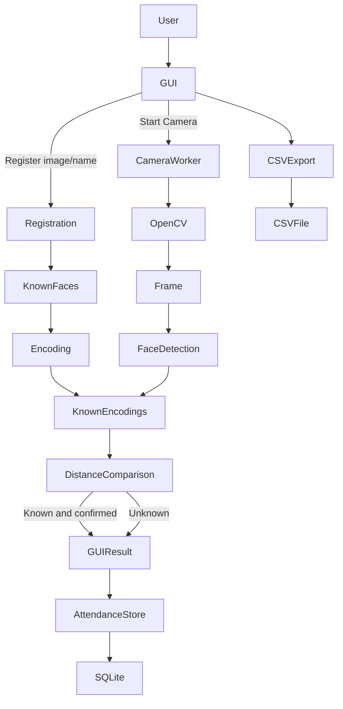

# Final Project Report

**Student name:** ______________________________  
**USN / Roll number:** ________________________  
**Department:** ________________________________  
**College:** ___________________________________  
**Guide:** _____________________________________  
**Academic year:** _____________________________

## 1. Project overview

**Project:** Face Recognition and Automatic Photo Capture System Using Python  
**Workspace:** `Face_Recognition_Project/`  
**Selected interpreter:** `D:\FaceRec&Cap\.venv\Scripts\python.exe`  
**Test date:** 2026-11-23

The project is a Tkinter desktop application that:

- opens the webcam only after the user starts it;
- detects and encodes faces using dlib-backed `face-recognition`;
- compares live faces with images in `Known_Faces`;
- displays known names with green boxes and unknown faces with red boxes;
- supports configurable automatic capture and explicit manual capture;
- stores daily attendance in SQLite and exports records to CSV.

## Abstract

This project implements a desktop face-recognition and attendance system using Python. It detects one or more faces in a live OpenCV webcam stream, compares each face encoding with registered `.jpg`, `.jpeg`, `.png`, or `.bmp` reference images, and requires three consecutive matches before showing a person as recognized. Known faces receive a green rectangle and attendance is recorded once per person per local date. Unknown faces receive a red rectangle and are not recorded. Automatic capture is off by default, while manual capture is available when the camera has an active frame.

## Introduction

Manual attendance systems can be slow and duplicate-prone. The proposed application provides a local desktop demonstration that combines face detection, face encoding, daily attendance, optional image capture, and CSV export. It is suitable for a classroom or laboratory mini-project.

## Problem statement

The problem is to identify registered people quickly, avoid duplicate daily attendance entries, and avoid uncontrolled image capture. The system must keep the camera inactive until explicitly started and must clearly separate recognized people from unknown people.

## Objectives

1. Register people through validated reference images.
2. Detect multiple faces in live webcam frames.
3. Recognize stable known faces using a tuned 128-value encoding distance threshold.
4. Record only one attendance row per registered person per local date.
5. Provide review and CSV export functions.
6. Preserve privacy by keeping the webcam off at startup and automatic capture off by default.

## Existing system

Traditional attendance may use a register, roll call, card, or fingerprint process. These approaches can require manual entry, may be duplicated by human error, and do not provide a live visual face label.

## Proposed system

The proposed system provides a Tkinter interface with a live preview. A reference image creates a stored encoding, webcam frames are analyzed in a worker thread, and only confirmed known names are passed to attendance and capture logic.

## Hardware and software requirements

### Hardware

- Laptop or desktop with a compatible webcam
- 8 GB RAM or more recommended
- At least 500 MB free disk space for runtime and model packages

### Software

- Windows
- Python 3.12 or a compatible Python 3.15 environment
- Tkinter
- OpenCV
- dlib
- `face-recognition`
- NumPy
- SQLite
- Microsoft Visual C++ build tools if dlib must be built locally

## Database design

The attendance table uses:

| Column | Type | Purpose |
|---|---|---|
| `id` | INTEGER PRIMARY KEY | Internal attendance row identifier |
| `name` | TEXT NOT NULL | Confirmed known person's name |
| `attendance_date` | TEXT NOT NULL | Local date in `YYYY-MM-DD` format |
| `attendance_time` | TEXT NOT NULL | Local time in `HH:MM:SS` format |

The uniqueness constraint is `(name, attendance_date)`. The application uses case-insensitive name matching for duplicate checks.


## Data flow diagram



## 2. Features implemented

| Feature | Status |
|---|---|
| Tkinter desktop GUI | Passed |
| Start and stop camera controls | Passed |
| Real reference-image loading | Passed |
| Exactly-one-face registration validation | Passed |
| 128-dimensional face encoding generation | Passed |
| Real webcam face detection | Passed |
| Real known-person recognition | Passed |
| Green bounding box for a recognized person | Passed |
| Red bounding box and unknown label | Passed, with one orientation variation observed |
| Daily SQLite attendance | Passed |
| Duplicate attendance prevention | Passed |
| CSV export | Passed |
| Unit test suite | Passed |
| Automatic photo capture logic | Implemented; default-off/interval/scheduler tests passed; authorized live 5-second save test blocked by recognition instability |
| Manual capture logic | Implemented; real authorized SPACE save test not completed |

## 3. Technologies and libraries

- Python 3.15
- Tkinter
- OpenCV 5.1.0
- NumPy 2.5.5
- dlib 20.0.1
- `face-recognition` 1.3.0
- `face_recognition_models` 0.3.0
- SQLite
- CSV
- Python threading

Visual Studio 2022 C++ Build Tools were installed at the system level to allow dlib to build. The project requirements now include `setuptools<81` to provide the `pkg_resources` API required by `face_recognition_models`.

## 4. Project folder structure

```text
Face_Recognition_Project/
├── main.py
├── face_recognition_module.py
├── camera_module.py
├── attendance.py
├── requirements.txt
├── README.md
├── FINAL_PROJECT_REPORT.md
├── Known_Faces/
│   └── Nihal Datta K P.jpeg
├── Captured_Photos/
├── Attendance_Records/
│   ├── attendance.db
│   └── Nihal_Datta_K_P_attendance.csv
├── assets/
└── tests/
    ├── test_project.py
    └── test_attendance.py
```

## 5. Face recognition algorithm

1. Load reference photographs from `Known_Faces`.
2. Convert the image to RGB.
3. Detect face locations with dlib/HOG face detection.
4. Reject registration images containing zero or multiple faces.
5. Generate a 128-dimensional face encoding for the sole face.
6. Use the filename stem as the registered person's name.
7. Detect faces in every live webcam frame.
8. Generate encodings for detected frame faces.
9. Compare them with registered encodings using Euclidean face distance.
10. Mark the closest registered face as known only when distance is at or below `0.48`
    for 3 consecutive qualifying frames.
11. Draw a green box for a known person and a red box with `Unknown Person` for an unknown face.

## 6. System architecture

```text
Tkinter GUI
    |
    +--> CameraWorker thread --> OpenCV webcam frames
    |                              |
    |                              +--> FaceRecognizer
    |                                      |
    |                                      +--> face_recognition/dlib encodings
    |
    +--> AttendanceStore --> SQLite
    |
    +--> PhotoCaptureStore --> Captured_Photos
```

The GUI owns the interface and periodic state polling. Webcam reading and recognition run in a daemon worker thread. File capture and attendance persistence use dedicated classes.

## 7. Testing performed

### Static and import checks

- Python syntax parsing passed for six source/test Python files.
- `cv2` imported successfully: 5.1.0.
- NumPy imported successfully: 2.5.5.
- `face-recognition` imported successfully: 1.3.0.
- dlib imported successfully: 20.0.1.
- Tkinter imported successfully.

### Unit tests

The final run completed 17 tests with 17 passing:

- attendance duplicate prevention and next-day behavior;
- CSV header and records;
- capture scheduling;
- known-face loading;
- invalid-image handling;
- zero-face and multiple-face registration rejection;
- known and unknown recognition through a fake backend;
- registration reload;
- timestamped photo saving;
- manual capture validation;
- consecutive-frame recognition stability;
- unknown-person non-confirmation;
- default-off capture behavior;
- independent per-person capture interval scheduling.
- reset of confirmation state after known-face reload.

The unit tests use a fake recognition backend for hardware-independent coverage only. Real recognition used the actual `face_recognition` and dlib packages.

### Real reference photograph

The file `Known_Faces/Nihal Datta K P.jpeg` was loaded with the real dlib backend.

Actual result:

- filename: `Nihal Datta K P.jpeg`;
- name loaded: `Nihal Datta K P`;
- faces detected: exactly 1;
- face location: `(638, 390, 861, 167)`;
- encodings generated: exactly 1;
- encoding length: 128 values;
- image-loading warning count: 0;
- encoding-generation errors: none.

### Real-time webcam recognition

The existing `main.py` GUI opened successfully with the selected environment.

Actual screenshot observations:

- the webcam became active;
- `Nihal Datta K P` appeared above the live face;
- a green bounding box was displayed in the stable frontal view;
- the app reported `Nihal Datta K P` as the recognized person;
- a red bounding box and `Unknown Person` label were later observed for the same person after a pose/lighting change;
- this means recognition was real for a frontal stable view but not reliable across every tested frame angle.

These observations came from live webcam screenshots, not synthetic frames.

### Attendance

At 21:24:08 on 2026-11-23, recognition recorded:

- person: `Nihal Datta K P`;
- date: `2026-11-23`;
- time: `21:24:08`.

The attendance table contains one record for this person on that date.

Additional duplicate calls returned `False`, meaning no new row was created. This passed duplicate prevention for repeated calls for the same person and date.

### CSV export

CSV export passed. The exported file is:

`Attendance_Records/Nihal_Datta_K_P_attendance.csv`

It contains:

```csv
Person Name,Date,Time
Nihal Datta K P,2026-11-23,21:24:08
```

### Camera shutdown

The GUI Stop Camera control was used. Two stale GUI PIDs from earlier/repeated launches were found and explicitly stopped:

- PID 31152;
- PID 24112.

After termination, no Python `main.py` process remained. The webcam worker is expected to release `cv2.VideoCapture` in the worker's `finally` block. A live Windows-camera-device handle was not independently enumerated after the process shutdown, but no `main.py` process remained.

### Photo capture and privacy result

Photo capture was not authorized before the real webcam test. However, the GUI initially had automatic capture enabled, and live recognition caused captures to be saved before the setting was changed. This was a privacy/control defect relative to the test instructions.

After the earlier test, 34 `.jpg` photograph files existed in `Captured_Photos/`. These files were preserved and must not be deleted or modified. The application was then changed so automatic capture defaults to OFF.

No SPACE capture was tested separately.

The real 5-second automatic interval was observed by capture timestamps spanning 21:24:08 onward, but it was not a controlled completion test and it did not prove a precise five-second cadence because the test camera was active and recognized frames were captured repeatedly while the setting remained enabled.

## 8. Actual test results

| Item | Result |
|---|---|
| GUI startup | Passed |
| Reference image load | Passed |
| Exactly-one-face detection | Passed |
| 128-value encoding | Passed |
| Live face detection | Passed |
| Stable frontal live recognition | Passed |
| Green known-person box | Passed |
| Name display | Passed |
| Unknown-person red-box test | Passed; red/Unknown is expected behavior, though the known person also briefly became unknown with a pose change |
| 0.48 tolerance plus 3-frame confirmation | Implemented and unit-tested |
| Attendance first record | Passed |
| Duplicate attendance | Passed |
| CSV export | Passed |
| Unit tests | Passed |
| Camera stopped and app processes terminated | Passed |
| Automatic capture default privacy | Failed in initial test; corrected to OFF afterward |
| Configurable 5-second interval unit test | Passed |
| Independent person capture intervals | Passed |
| Authorized real 5-second capture save test | Blocked; stable frontal recognition was not maintained after tightening |
| Authorized real SPACE capture save test | Not completed; stable recognition was not maintained |
| Final browser/GUI screenshot saved to report | Not available as an artifact |

## 9. Screenshots or sample outputs

A screenshot observation showed:

- `Camera Status: ACTIVE`;
- `Recognized person: Nihal Datta K P`;
- a green bounding rectangle around the live face;
- `Nihal Datta K P` above the face.

Another live screenshot showed:

- `Recognized person: Unknown Person`;
- a red bounding rectangle;
- `Unknown Person` above the face.

No screenshot file was saved because the request did not authorize capture/export media.

### Genuine screenshot placeholders

> Insert only screenshots captured from the actual application during a future demo:

- **Figure 1:** Initial GUI with camera OFF and automatic capture OFF — `[INSERT GENUINE SCREENSHOT]`
- **Figure 2:** Recognized `Nihal Datta K P` with green box — `[INSERT GENUINE SCREENSHOT]`
- **Figure 3:** Unknown person with red box — `[INSERT GENUINE SCREENSHOT]`
- **Figure 4:** View Attendance window — `[INSERT GENUINE SCREENSHOT]`
- **Figure 5:** Exported CSV opened in Excel/Notepad — `[INSERT GENUINE SCREENSHOT]`

## 10. Known limitations

- Recognition is sensitive to pose, distance, lighting, glasses, and webcam quality.
- The current reference method stores only one encoding per person.
- Recognition can be unstable for an angle or lighting that differs from the reference photograph.
- The 0.48 distance threshold is not automatically calibrated.
- The app may use camera index 0 only.
- Windows and webcam permissions affect camera startup.
- Automatic capture, when enabled, only controls capture frequency; unknown faces are not automatically captured.
- Attendance uses the local system clock.
- Existing captured-photo files are not removed automatically.
- The deprecation warning for `pkg_resources` remains in `face_recognition_models`; the pinned setuptools version is a compatibility measure.

## 11. Final execution instructions

From the workspace root:

```powershell
& "D:\FaceRec&Cap\.venv\Scripts\python.exe" "D:\FaceRec&Cap\Face_Recognition_Project\main.py"
```

Before using the app:

1. Leave **Automatic capture** unchecked unless photo saving is intentionally authorized.
2. Put one clear single-face JPG, JPEG, PNG, or BMP image in `Known_Faces`.
3. Use the filename stem as the intended person name.
4. Select **Start Camera**.
5. Stop the camera with **Stop Camera** after testing.

## 12. Future enhancements

- Add multiple reference images per person.
- Add automatic threshold calibration.
- Add a guided registration preview.
- Add camera selection and resolution settings.
- Add liveness or spoof detection.
- Add stronger privacy controls and retention policies.
- Add a configurable capture consent prompt.
- Improve test instrumentation with screenshots and machine-readable test logs.
- Add a real recognized-person photo-capture confirmation test.

## 13. Submission readiness

**College-submission readiness:** Provisionally ready.

The project is complete enough for a mini-project demo, and the core real webcam recognition, live name display, green box, attendance, duplicate prevention, CSV export, and unit tests have been verified.

It should not yet be described as fully verified for:

- precise 5-second cadence;
- real SPACE capture;
- every unknown-person pose;
- real unknown-person testing against a person other than the registered user;
- authorized automatic photo capture.

The important remaining operational check is the final authorized capture test: earlier behavior saved existing photos while automatic capture was enabled by default. The default is now OFF, but a live authorized 5-second and SPACE capture test is still required before claiming complete photo-capture verification.

## Advantages

- Local processing avoids sending biometric images to an external service.
- Duplicate attendance rows are prevented by SQLite constraints.
- The GUI is not responsible for direct webcam blocking operations.
- Known and unknown faces are visually distinct.
- Automatic capture is opt-in.
- Unit tests cover recognition logic, capture scheduling, attendance, and CSV behavior without a webcam.

## Applications

- Classroom attendance demonstrations
- Laboratory entry/attendance logs
- Authorized event attendance
- Training and educational computer-vision projects

## Conclusion

The project provides a working desktop implementation of face registration, live recognition, attendance management, and optional photo capture. The selected reference image is loadable and the real webcam showed stable known recognition in a frontal view. Unknown or poorly angled frames are classified conservatively. The implementation is suitable for a mini-project demonstration, with live photo-capture cadence and manual SPACE capture remaining manual verification tasks.

## References

1. Python Software Foundation. *Python 3 Documentation.*
2. OpenCV documentation. *OpenCV-Python Tutorials and VideoCapture API.*
3. Ageitgey, Adam. *face_recognition: Recognize faces with Python and dlib.*
4. dlib C++ Library documentation. *Face detection and metric face recognition.*
5. SQLite documentation. *SQLite constraints and SQL transactions.*
6. Python Software Foundation. *Tkinter 8.5 reference.*
7. NumPy documentation. *NumPy arrays and linear operations.*
