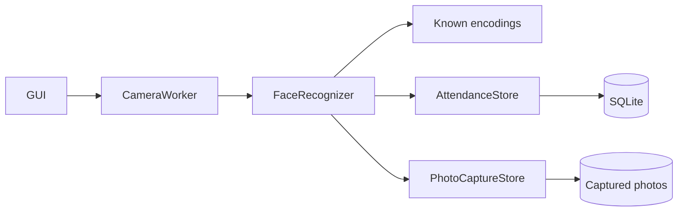

# 8-Slide Presentation Content

## Slide 1 — Title

- Face Recognition and Automatic Photo Capture System Using Python
- Mini-project demonstration
- Student: ____________________
- USN: ____________________
- Department: ____________________
- College: ____________________
- Guide: ____________________

## Slide 2 — Introduction and problem statement

- Manual attendance and photo recording are slow and error-prone.
- Repeated entries and identity confusion reduce reliability.
- Proposed solution: live face detection, confirmation, attendance, and optional capture.

## Slide 3 — Objectives

- Recognize registered people through a laptop webcam.
- Label unknown faces.
- Record duplicate-resistant attendance.
- Support manual and interval-controlled photo capture.
- Preserve privacy by default.

## Slide 4 — Technologies

- Python and Tkinter
- OpenCV
- dlib and `face-recognition`
- NumPy
- SQLite
- CSV
- Threading

## Slide 5 — System architecture

## Slide 6 — Face recognition methodology

1. Load the registered image.
2. Detect exactly one face.
3. Generate a 128-value encoding.
4. Compare live encodings by Euclidean distance.
5. Use threshold `0.48`.
6. Require three qualifying frames.
7. Show green or red result.

## Slide 7 — Demo and testing

- GUI initialization: camera OFF, automatic capture OFF.
- Reference: exactly one face and one 128-value encoding.
- Hardware-independent tests: 15 passed.
- Live real person: name and green box verified in the stable frontal position.
- Unknown pose: red `Unknown Person` box observed.
- CSV attendance export verified.

## Slide 8 — Applications, limitations, conclusion

- Applications: classroom attendance, lab access logging, authorized event monitoring.
- Limitations: pose and lighting sensitivity, one reference image, no liveness check.
- Future scope: multiple reference images, threshold calibration, liveness, camera selection.
- Conclusion: privacy-aware desktop mini-project with SQLite attendance and optional capture.
