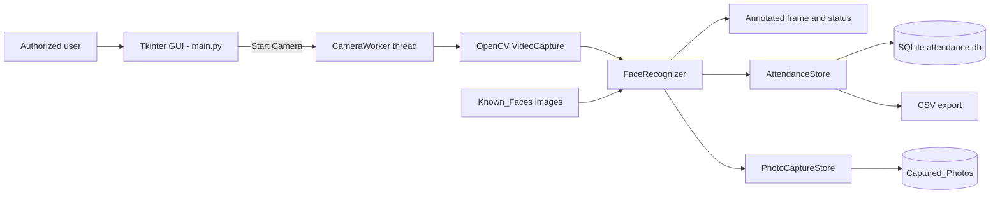
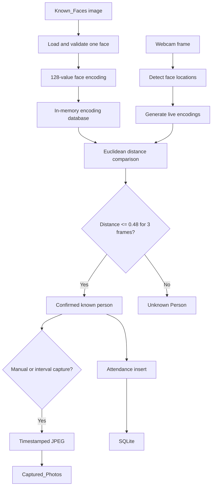
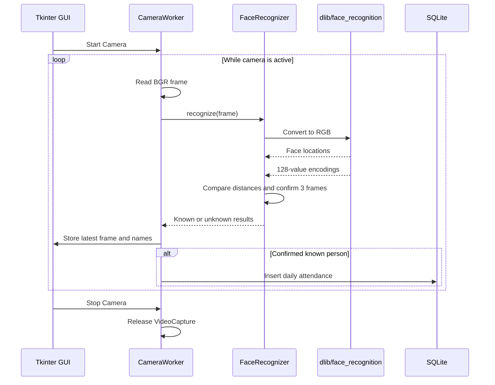

# Project Architecture

## 1. Overall system architecture

## 2. Module responsibilities

| Module | Responsibility |
|---|---|
| `main.py` | Tkinter interface, user actions, webcam start/stop, frame display, registration queue, attendance and CSV controls |
| `face_recognition_module.py` | Reference-image validation, dlib/face-recognition encoding generation, tolerance matching, unknown classification, confirmation gate |
| `camera_module.py` | Webcam thread, frame snapshot, per-person capture scheduler, manual capture, photo storage |
| `attendance.py` | SQLite schema, duplicate-resistant insert, record query, UTF-8 CSV export |
| `tests/test_project.py` | Hardware-independent recognition, validation, capture, and scheduler tests |
| `tests/test_attendance.py` | SQLite duplicate and CSV tests |

## 3. Data flow diagram

## 4. Recognition pipeline

## 5. Thread and resource behavior

- The camera loop runs in a daemon worker thread.
- Tkinter state is updated from the GUI polling loop.
- The worker stores frame data and results under locks.
- `CaptureScheduler` maintains separate monotonic timestamps per person.
- `VideoCapture.release()` runs in the worker's `finally` block.
- `Exit` and `Stop Camera` request worker shutdown.

## 6. Database design

Table: `attendance`

| Column | Type | Constraint |
|---|---|---|
| `id` | INTEGER | Primary key |
| `name` | TEXT | Not null |
| `attendance_date` | TEXT | `YYYY-MM-DD` |
| `attendance_time` | TEXT | `HH:MM:SS` |

Unique constraint: `(name, attendance_date)`.

## 7. Privacy boundaries

- Camera access is not initiated during initialization.
- Automatic capture defaults to OFF.
- Manual capture requires an active camera frame.
- Unknown people are not recorded or automatically captured.
- Existing files are never overwritten because filenames include microsecond timestamps.
