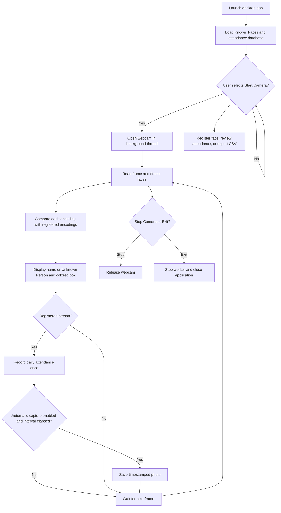

# Face Recognition and Automatic Photo Capture System

## Project introduction

This is a Python desktop application for identifying people who have explicitly
been registered, capturing timestamped photos, and keeping a local daily
attendance log. The Tkinter interface displays the webcam preview and provides
camera, registration, capture, and attendance controls.

The webcam is **not** opened when the application starts. It is accessed only
after the user selects **Start Camera**. Automatic photo capture is disabled by
default, can be enabled explicitly in the interface, and uses a configurable per-person
interval (5 seconds by default). A manual capture is made only when the user
selects **Capture Photo**.

## Abstract

The application loads one reference image per registered person from
`Known_Faces`, computes a face encoding, and compares detected webcam faces to
the registered encodings. Each face is labeled with the closest registered
name when its distance is within the configured recognition tolerance.
Otherwise the face is labeled **Unknown Person**. Registered people receive a
green box and unknown people a red box. Recognition can trigger an automatic
timestamped photo and a single attendance entry for that person on the local
calendar day. Attendance is stored in SQLite and can be reviewed or exported to
CSV.

## Objectives

- Detect and recognize more than one face in a live camera stream.
- Clearly distinguish registered and unknown people in the preview.
- Capture photos automatically at a controlled per-person interval and on
  explicit manual request.
- Let operators register a person from a validated image through the GUI.
- Keep persistent, duplicate-resistant daily attendance records.
- Keep camera capture and recognition off the Tkinter event thread.
- Release the camera cleanly when stopped or when the application exits.

## Technologies used

- Python 3
- OpenCV (`opencv-python`) for image loading, webcam access, drawing, and JPEG
  encoding
- `face-recognition` (dlib) for face detection and face encodings
- NumPy for image/encoding arrays
- Tkinter and ttk for the desktop interface
- SQLite (`sqlite3`) for attendance
- Python `csv` module for CSV export
- Python threading and queues for background camera and registration tasks

Tkinter, SQLite, CSV, threading, and the other standard-library modules are
provided by Python and are not listed as pip dependencies.

## Project architecture

- **`main.py`** — Builds the Tkinter UI, starts/stops the camera on request,
  displays annotated frames, and connects registration and attendance controls.
- **`camera_module.py`** — Owns the background webcam worker, capture interval
  scheduler, and timestamped photo storage.
- **`face_recognition_module.py`** — Loads and validates reference images,
  registers people, and returns a match for each face in a frame.
- **`attendance.py`** — Creates and queries the SQLite attendance table and
  writes CSV exports.
- **`tests/test_project.py`** — Exercises recognition behavior with a fake
  backend and tests persistence/capture logic without requiring a webcam.

### Recognition algorithm

1. Load a reference image and convert it from OpenCV BGR to RGB.
2. Detect faces and require exactly one face for each registration image.
3. Generate and store the face encoding under the image filename's stem.
4. For each camera frame, detect all face locations and generate encodings.
5. Compute the distance from each encoding to the registered encodings.
6. Select the nearest registered encoding. If its distance is at most `0.48`,
   display that person's name; otherwise label the face **Unknown Person**.
   Require 3 consecutive qualifying frames before showing a known name.
7. Record attendance once per person per local date. If automatic capture is
   enabled, save the recognized person's frame no more often than the configured
   interval.

The `0.48` distance tolerance is set in `FaceRecognizer` and may need adjustment
for the camera, lighting, and images in a particular environment. Lower values
are stricter.

### Application flow



## Folder structure

```text
Face_Recognition_Project/
├── main.py
├── face_recognition_module.py
├── camera_module.py
├── attendance.py
├── requirements.txt
├── README.md
├── Known_Faces/
├── Captured_Photos/
├── Attendance_Records/
├── assets/
└── tests/
    ├── test_project.py
    └── test_attendance.py
```

`Known_Faces/`, `Captured_Photos/`, and `Attendance_Records/` are created on
startup if they do not yet exist. The database is
`Attendance_Records/attendance.db`.

## Installation

1. Use a Python environment with Tkinter available.
2. Install the listed packages if they are not already installed:

   ```powershell
   python -m pip install -r requirements.txt
   ```

   `face-recognition` depends on dlib. Installing dlib can require a compatible
   wheel or native build tools on some Windows/Python combinations; use a
   compatible preinstalled environment if installation is not available.
3. Connect a webcam and grant the application permission to use it.

## Execution

From the workspace root:

```powershell
python Face_Recognition_Project\main.py
```

Or change into `Face_Recognition_Project` and run:

```powershell
python main.py
```

The app starts with the camera off. Select **Start Camera** to request camera
access. **Stop Camera** releases the webcam; **Exit** also stops the worker and
closes the window.

## How to register faces

1. Select **Register Face**.
2. Enter the person's display name.
3. Choose a JPG, JPEG, PNG, or BMP file containing exactly one clearly visible
   face.
4. The app validates the image, copies it into `Known_Faces/` using the entered
   name as its filename, and reloads the registered encodings.

The app rejects unreadable images, images with no face, images with more than
one face, unsupported formats, invalid filenames, and duplicate registered
names. For additional people, repeat the process with a different name.

You may also place one valid image per person in `Known_Faces/` before launch;
the filename without its extension is used as the name.

## How attendance works

When a registered person is recognized, their name, local date, and local time
are inserted into SQLite. A database uniqueness constraint prevents a second
entry for the same person on the same date, even across application restarts.
The attendance API also rejects the reserved `Unknown Person` label directly.
**View Attendance** opens the records list, and **Export CSV** lets you save a
CSV copy to a chosen location.

## How automatic photo capture works

Automatic capture is off by default and can be enabled in **Capture Settings**.
Stopping the camera disables automatic capture as a safety measure.
The default per-person interval is 5 seconds and can be changed while the
camera is running. Each captured JPEG is stored in `Captured_Photos/` with the
person name and timestamp in its filename. The interval is tracked separately
for each registered person. Unknown faces are not automatically captured.

**Capture Photo** explicitly saves the current camera frame even when automatic
capture is disabled. A manual image is labeled with the recognized name(s), or
`Manual_Capture` if no registered person is visible. Images are not saved merely
by launching the application or opening the camera; automatic saving follows
the configured setting and interval.

## Limitations

- Face-recognition accuracy depends on image quality, face angle, lighting,
  camera resolution, and the selected tolerance; this is not a liveness or
  identity-verification system.
- Each registration image must contain exactly one face. Multiple reference
  images per person are not currently supported.
- The default camera device index is `0`. External cameras may need a code
  change to select a different index.
- Camera access and dlib availability depend on the operating system,
  installed drivers, and compatible native dependencies.
- Attendance timestamps use the computer's local clock and timezone.
- Recognition and attendance are intended for authorized local use. Protect
  reference images, captured photos, and the attendance database appropriately.

## Future enhancements

- Support multiple reference images and per-person encoding refresh.
- Add configurable camera selection, resolution, and recognition threshold.
- Add retention controls, encrypted storage, and explicit consent/workflow
  management for biometric data.
- Add attendance search, date filters, and richer reports.
- Add optional liveness checks and camera-performance tuning.
- Package the application for simplified installation on supported platforms.

## Tests

Run the hardware-independent tests from this directory:

```powershell
python -m unittest discover -s tests -v
```

The hardware-independent suite uses a deterministic fake face-recognition backend
for image and matching logic. The current suite contains 17 tests covering
registration validation, confirmation stability, capture scheduling, manual
capture safety, duplicate attendance, unknown-person rejection, and CSV export.
Webcam operation itself requires an available camera and is not verified by the
hardware-independent unit suite.
